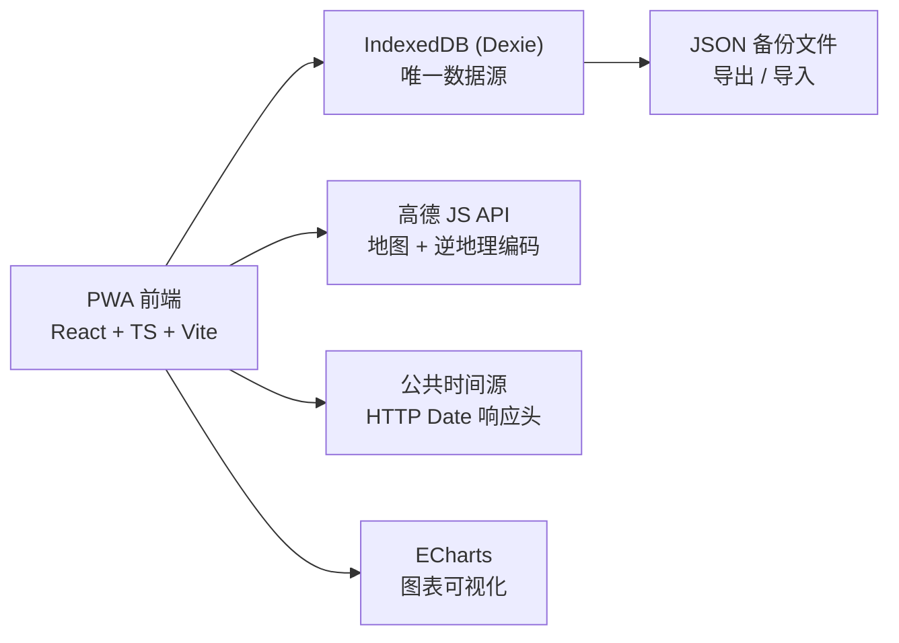

# 打卡应用 PRD

| 项目 | 内容 |
| --- | --- |
| 产品名称 | 打卡应用（暂定名 `check_app`） |
| 文档版本 | v1.0 |
| 文档状态 | **已定稿**（评审结论 A / A / B，见 §12） |
| 最后更新 | 2026-10-12 |
| 产品形态 | Web PWA（个人自用，**纯本地存储、无账号**，不涉及团队 / 管理端） |
| 关联文档 | `DECISIONS.md`（决策记录）、`TECH-DESIGN.md`（待生成）、`TASKS.md`（待生成） |

---

## 1. 产品定位

一个**只给本人使用**的工时记录工具：

> 打卡即记录「联网校准的时间」+「打卡时刻一次定位得到的地点」，自动累计每日 / 每周 / 每月工作多久，并能看到自己在各个地点分别投入了多少时间。

**核心假设**（如不成立需重新评审）

- 单人使用，无团队、无管理端、无审批流；
- **无地理围栏约束**，地点仅用于记录与统计，不用于限制打卡；
- 无需提醒推送；
- 打卡为纯手动操作，采用「多段开始 / 结束」形态；
- **数据仅存本地设备（IndexedDB），不做账号体系与云端同步**（决策 D-012 选 B）；
- 打卡结果与统计数据**必须有可视化界面呈现**，而非仅数字罗列（决策 D-014）。

**设计原则**

1. **零摩擦**：任何时候点一下就能打卡，定位失败也不阻塞打卡。
2. **地点是标签，不是门禁**：匹配不到地点照常打卡，只是地点为「未命名」。
3. **隐私最小化**：仅打卡时刻采集一次位置，不做持续轨迹记录，数据不离开设备。
4. **时间可信**：以联网校准的时间为准，设备本地时间仅作参考并记录偏差。
5. **看得见**：每次打卡都有可视化的结果反馈，统计以图表优先呈现。

---

## 2. 需求演进（v0.1 → v1.0）

| 项目 | v0.1（团队考勤） | v1.0（个人工时记录） |
| --- | --- | --- |
| 使用场景 | 小团队考勤 | **个人工时自记录** |
| 打卡方式 | 手动 + 地理围栏自动打卡 | **仅手动，多段开始 / 结束** |
| 地理围栏 | 有（校验是否在范围内） | **删除** |
| 地点用途 | 范围校验、反作弊 | **记录展示 + 按地点汇总工时** |
| 反作弊 / 审批流 / 管理端报表 | 有 | **全部删除** |
| 存储与账号 | 云服务（Supabase）+ 账号登录 | **纯本地存储，无账号** |
| 结果呈现 | 数字列表为主 | **可视化卡片 + 图表优先** |
| 提醒推送 | P1 | **删除** |
| 复杂度 | 高（含权限矩阵、异常告警） | **低** |

> 说明：删除围栏约束后，PWA 最大的技术风险（浏览器无法可靠后台定位、iOS Safari 后台冻结）不再影响本产品，Web 技术栈完全够用。

---

## 3. 用户与使用场景

**用户画像**：需要自我记录工作时长的个人（自由职业者 / 远程办公 / 想复盘时间分配的人）。

**典型场景**

1. 早上坐到桌前 → 打开应用点【开始工作】，页面显示校准时间、当前位置与地址。
2. 中午去吃饭 → 点【结束工作】，再点【开始工作】，两段自动分开计算。
3. 下午换到咖啡馆继续干活 → 打卡，系统自动匹配到「XX 咖啡」地点。
4. 晚上收工 → 点【结束工作】，看到今天累计 7 小时 40 分。
5. 周末复盘 → 看本周柱状图，发现「公司 32h / 咖啡馆 6h / 家 4h」。
6. 忘记点结束 → 界面常驻计时提醒，事后可修正（P1）。

---

## 4. 功能需求（P0）

### 4.1 联网校准时间

> 说明：D-012 选定「纯本地存储、无账号」，因此**没有自建服务端**。时间校准改为向公共时间源请求并读取响应时间（HTTP `Date` 响应头），按最小 RTT 采样校正，等价于 NTP 的简化实现。

| 编号 | 需求 | 说明 |
| --- | --- | --- |
| T-1 | 网络时间为准 | 打卡时间取「校准后的网络时间」；设备本地时间另存为参考字段并记录两者偏差 |
| T-2 | 时钟偏移校正 | 多次采样（记录发包 / 收包时刻，取最小 RTT 样本）计算与时间源的偏移量，页面顶部显示校准后时钟 |
| T-3 | 同步状态可视 | 顶部显示「同步中 / 已同步 / 离线」状态、偏差值，以及该条记录的时间来源（网络 / 本地） |
| T-4 | 时钟异常提示 | 校准发现设备时间与网络时间偏差 > 60s 时提示"设备时间异常"，该条记录打标 |
| T-5 | 断网降级 | 无网时使用本地时间落库并标记 `offline`；恢复网络后**补记校准参照值而不篡改历史时间**，报表中区分展示 |

### 4.2 多段打卡

| 编号 | 需求 | 说明 |
| --- | --- | --- |
| C-1 | 单按钮状态切换 | 主界面一个主按钮，随状态在【开始工作】/【结束工作】间切换 |
| C-2 | 多段循环 | 一天可多次「开始 → 结束」循环，段与段独立计算（午休、外出均可分开） |
| C-3 | 记录内容 | 每次打卡记录：时间、坐标、定位精度、逆地理地址、匹配到的地点 |
| C-4 | 进行中计时 | 存在未结束的段时，界面常驻显示已工作时长（实时走秒） |
| C-5 | 异常长段提醒 | 段持续超过阈值（默认 12 小时）时弹窗确认："还在工作吗？" |
| C-6 | 幂等保障 | 客户端生成幂等键，重复点击 / 离线重放不产生重复记录 |
| C-7 | 历史列表 | 今日时间轴展示当日所有段（起止、时长、地点），可展开查看坐标明细 |

### 4.3 打卡即记录地点

| 编号 | 需求 | 说明 |
| --- | --- | --- |
| L-1 | 单次定位 | 打卡时调用一次定位（`getCurrentPosition`），**不使用** `watchPosition` 持续追踪，省电且隐私友好 |
| L-2 | 失败不阻塞 | 定位失败 / 被拒绝 / 超时时，**照常完成打卡**，地点留空并标注"未记录地点" |
| L-3 | 地址解析 | 通过第三方地图服务将坐标转为人类可读地址（逆地理编码） |
| L-4 | 地点展示 | 打卡记录旁展示：地址文字 + 小地图缩略图 + 定位精度（如 ±25m） |
| L-5 | 事后补地点 | 未记录地点的打卡，允许事后手动补充（P1 随编辑功能一起落地） |

### 4.4 地点体系与按地点汇总

**策略：用户自定义地点 + 最近匹配**（决策 D-010 方案 A）

| 编号 | 需求 | 说明 |
| --- | --- | --- |
| P-1 | 地点管理 | 可新增 / 编辑 / 删除地点：名称、坐标、半径（默认 200m）、颜色或图标 |
| P-2 | 自动匹配 | 打卡坐标落在某地点半径内 → 自动关联该地点 |
| P-3 | 未匹配处理 | 显示原始地址，并提供「一键命名为新地点」入口 |
| P-4 | 地点汇总视图 | 本周 / 本月各地点累计时长 + 占比（环形图或条形图），支持下钻查看该地点的历史打卡记录 |
| P-5 | 地图回顾 | 在地图上展示历史打卡点分布（P1） |

> 本质是「贴标签」而不是「做限制」：匹配不上照样能打卡。

### 4.5 工时统计口径

| 规则 | 定义 |
| --- | --- |
| 计时单元 | **段（segment）= 开始 → 结束**，成对闭合 |
| 日工时 | Σ 有效段时长 |
| 有效段阈值 | 段时长 < 1 分钟（可配置）标记为「碎片」，保留记录但不计入工时 |
| 跨天处理 | 段跨 0 点时归属**开始日**（支持熬夜工作）；业务日边界可配置，默认凌晨 4:00 换日 |
| 未闭合段 | 不自动伪造工时；持续计时并提示确认，支持事后修正结束时间（P1） |
| 汇总维度 | 今日 / 本周 / 本月 / 自定义区间，且均可**按地点**再拆分 |
| 目标与达成 | 日目标（默认 8h）、周目标（默认 40h），展示达成率进度条 |
| 呈现形式 | 今日时间轴 + 周 / 月柱状图 + 日历热力图（P1） |

### 4.6 页面与信息架构

| 页面 | 主要内容 | 可视化元素 |
| --- | --- | --- |
| 打卡首页 | 校准时钟 + 同步状态、主打卡按钮、进行中计时、当前位置与地址、今日累计工时 | 今日目标环形进度、打卡结果卡片、实时走秒计时器 |
| 记录页 | 今日时间轴（段列表）、按日期切换、地点标签 | 甘特式时间轴条、每段地点缩略图 |
| 统计页 | 日 / 周 / 月工时汇总、目标达成率、按地点汇总 | 柱状图、趋势折线、地点占比环形图、日历热力图（P1） |
| 地点页 | 地点列表（增删改）、地图展示、各地点累计时长 | 地图打卡点分布、地点时长条形图 |
| 设置页 | 日 / 周目标、业务日边界、碎片阈值、数据备份与恢复 | 存储占用概览、上次备份时间 |

### 4.7 打卡结果呈现与数据可视化（P0）

**原则**：每次打卡都要有明确的**即时视觉反馈**；统计以**图表优先**呈现，而不是把数字堆在列表里。

| 编号 | 需求 | 说明 |
| --- | --- | --- |
| V-1 | 打卡结果卡片 | 点击打卡后弹出结果卡片：动作（开始 / 结束）、校准时间、本次或累计时长、地点名称 + 地址 + 精度、地图缩略图、是否关联到已有地点 |
| V-2 | 状态可视化 | 首页用**环形进度**展示今日目标达成度；进行中的段用实时走秒计时器 + 呼吸动效示意"计时中" |
| V-3 | 今日时间轴 | 以横向甘特式时间轴呈现当日各段起止与时长，点按展开该段的地点与坐标明细 |
| V-4 | 周期柱状图 | 周 / 月工时柱状图，叠加目标参考线，直观看出达标与缺口 |
| V-5 | 地点占比图 | 环形图或堆叠条展示各地点时长占比，配色与地点色标一致（与地点管理中的颜色联动） |
| V-6 | 地图可视化 | 地图标注历史打卡点，点的大小 / 深浅表示该点累计时长（P0 先做首页缩略图，完整版为 P1） |
| V-7 | 日历热力图 | 月度日历热力图，颜色深浅表示当日工时（P1） |
| V-8 | 空态与加载态 | 无数据时给出引导性空态（"今天还没有打卡"）；图表加载显示骨架屏，不留白屏 |

**图表实现**：统一采用 **ECharts**（`echarts` + `echarts-for-react`）。理由：一个依赖即可覆盖柱状图、折线、环形、日历热力图与地图散点，中文文档完善，避免为不同图表引入多套库。

---

## 5. 二期功能（P1）

| 功能 | 说明 |
| --- | --- |
| 手动补录 / 编辑 | 补一段「14:00–17:00」，或修正错误的结束时间，保留修改痕迹 |
| 离线补传 | 断网时本地落库（IndexedDB），恢复网络后自动同步 |
| 数据导出 | CSV / Excel |
| 日历热力图 | 按月查看每天工时深浅分布（可视化 V-7） |
| 地图回顾 | 历史打卡点地图分布（可视化 V-6 完整版） |
| 备份与恢复 | 一键导出 / 导入 JSON 备份文件（**纯本地存储下的数据安全兜底**，见 §9） |

---

## 6. 非功能需求

| 类别 | 指标 / 要求 |
| --- | --- |
| 性能 | 冷启动 P75 < 2s；点击打卡到落库 < 3s（含定位耗时） |
| 可靠性 | 定位失败不阻塞打卡；离线可打卡，联网后自动补传 |
| 兼容性 | iOS Safari ≥ 16 / Android Chrome / 桌面 Chrome；**必须 HTTPS**（定位 API 强制要求安全上下文） |
| 隐私 | 仅打卡时刻采集一次位置，不做持续轨迹；**数据只存本机、不上传服务器**；支持一键导出备份与清除全部数据 |
| 可维护性 | 地图 / 逆地理服务抽象为 provider 接口，可替换（高德 / 腾讯 / 百度） |
| 数据保留 | 默认长期保留，用户可自行导出或删除全部数据 |

---

## 7. 数据模型

存储介质：浏览器 **IndexedDB**（通过 Dexie 管理）。无服务端数据库、无 `user_id` 字段。

| 表 | 关键字段 |
| --- | --- |
| `sessions`（打卡段） | `id`、`started_at`、`ended_at`、`duration_seconds`、起止坐标与精度、地址、`place_id`、来源（在线 / 离线）、幂等键、设备本地时间与网络时间的偏差 |
| `places`（地点） | `id`、`name`、`lat`、`lng`、`radius_m`、颜色 / 图标 |
| `settings` | 日目标、周目标、业务日边界、碎片阈值、时间源配置 |
| `meta` | 数据库版本、最后备份时间、时间校准偏移量 |

**数据安全要求（纯本地方案下的重点）**

1. **备份机制**：提供 JSON 全量导出 / 导入；设置页展示"上次备份时间"，超过 7 天未备份时提醒（对齐 Safari 存储清理策略，见 §9）。
2. **软删除**：删除地点或记录采用软删除标记，避免误操作不可恢复。
3. **备份加密（可选，P1）**：如需更强隐私，可对导出的备份文件加密。
4. 位置数据**仅存本机、不产生任何上传行为**——这是本方案最大的隐私优势。

---

## 8. 技术方案

| 层 | 选型 | 说明 |
| --- | --- | --- |
| 前端 | React + TypeScript + Vite | 编译快、生态成熟，单人项目维护成本低 |
| PWA | 可安装到桌面 / 主屏幕 | 全屏与图标体验更接近原生；注意存储清理风险（§9） |
| 本地存储 | Dexie（IndexedDB） | **唯一数据源**，离线队列与本地缓存合一 |
| 状态与渲染 | Dexie `liveQuery` 驱动响应式更新 | 数据变更即时反映到图表与列表 |
| 图表可视化 | ECharts + echarts-for-react | 一个依赖覆盖柱状 / 折线 / 环形 / 日历热力图 / 地图散点 |
| 地图与地址 | 高德 JS API | 境内逆地理编码最稳定；**高德返回 GCJ-02 坐标，需与 WGS84 统一坐标系**，转换逻辑封装在 provider 层 |
| 时间校准 | 公共时间源（读取 HTTP `Date` 响应头） | 无自建后端，用最小 RTT 采样实现 NTP 式校正 |
| 后端 | **无** | 无账号、无服务器、无数据库；数据不离开设备 |
| 部署 | Vercel / Cloudflare Pages 等静态托管 | 自动提供 HTTPS（定位 API 强制要求安全上下文） |

> 详细设计（本地表结构、数据流、状态机、目录结构、坐标转换、备份格式）见后续 `TECH-DESIGN.md`。

---

## 9. 风险与对策

| 风险 | 影响 | 对策 |
| --- | --- | --- |
| 室内 / 地下定位失败或精度差 | 地点记录缺失或不准 | 不阻塞打卡；展示精度值；支持事后补地点；P1 提供手动补录 |
| 忘记点「结束」导致时长虚高 | 统计失真 | 界面常驻计时 + 异常长段（>12h）弹窗确认 + P1 支持修正结束时间 |
| **浏览器清理本地数据**（Safari 对长期无访问的站点有存储清理策略，用户也可能手动清除站点数据） | **打卡数据永久丢失** | 主动备份机制：设置页展示上次备份时间、超 7 天提醒；一键导出 / 导入 JSON；引导"添加到主屏幕"以降低被清理概率 |
| 公共时间源不可用 | 无法联网校准 | 配置多个时间源按优先级降级；全部失败时使用本地时间并明确标注"未校准" |
| 地图 Key 暴露在前端 | Key 被滥用、配额耗尽 | 高德 Key 配置域名白名单与调用限额；provider 层可切换服务商 |
| 坐标系差异（GCJ-02 vs WGS84） | 打卡点在地图上偏移数百米 | 在 provider 层统一做坐标转换，读写两向都做归一化 |
| 图表与明细数字不一致 | 用户不信任数据 | 图表与明细统一由同一份汇总函数产出，纳入验收标准（§13） |
| 位置数据隐私 | 隐私风险 | 仅打卡时刻采集一次；数据不出设备；支持导出与彻底清除 |

---

## 10. 里程碑

| 阶段 | 内容 | 交付标志 |
| --- | --- | --- |
| M1 打卡核心 | 联网校准时钟 + 实时地点显示 + 多段开始 / 结束打卡 + 今日时间轴 + **备份导出 / 导入** | 能完整记录一天的多段打卡，且数据可导出 |
| M2 统计与可视化 | 日 / 周 / 月工时汇总、目标达成率、柱状图、结果卡片动效 | 能看到工时趋势与达成率 |
| M3 地点体系 | 自定义地点 + 自动匹配 + 按地点汇总 + 地图展示 | 能回答"我在各地点分别待了多久" |
| M4 体验完善 | 手动补录 / 编辑、离线补传、CSV 导出、日历热力图 | 漏打卡可补救，数据可带走 |
| M5 完善 | PWA 安装引导、公共时间源容错、多时间源切换、备份加密（可选） | 安装体验完善，数据更安全 |

> ⚠️ 备份能力**提前到 M1**：纯本地存储下，数据丢失是最高风险，必须先有兜底再谈功能。

---

## 11. 明确不做

围栏约束与自动打卡、提醒推送、团队 / 管理端、审批流、反作弊、薪资计算、持续轨迹记录、人脸 / 指纹识别、原生 App、多语言、**账号体系与云端同步**。

---

## 12. 决策结论

**评审结论：A / A / B**（2026-10-12 拍板）

| 编号 | 议题 | 结论 | 关键影响 |
| --- | --- | --- | --- |
| D-010 | 地点识别策略 | **A** 用户自定义地点 + 最近匹配 | 地点具备稳定身份与人类可读名称，支撑按地点汇总（§4.4） |
| D-011 | 忘记结束打卡的处理 | **A** 继续计时 + 超 12h 弹窗确认 + P1 事后修正 | 不自动伪造工时；落地 §4.2 C-5 与 P1 编辑功能 |
| D-012 | 登录方式 | **B** 纯本地存储，无账号 | **重大影响**：删除 Supabase 与账号体系；原 M5「多设备同步」改为「备份文件迁移」；新增备份机制（§7）与存储清理风险（§9）；时间校准改为公共时间源（§4.1） |

**连带变更**

- 原决策 D-009（云服务 / BaaS）**作废**，被 D-013（纯本地存储）取代，详见 `DECISIONS.md`。
- 新增决策 D-014：打卡结果与统计必须有可视化呈现，图表统一用 ECharts（§4.7）。

---

## 13. 验收标准（P0）

1. 断网状态下点击打卡，记录仍能落库；恢复网络后自动同步且**不产生重复条目**。
2. 打卡成功后**必定弹出可视化结果卡片**（时间 / 地点 / 时长 / 地图缩略图），首页今日达成度环形进度随之更新。
3. 一天内多次「开始 / 结束」循环，各段时长与总工时计算正确，跨 0 点的段归属开始日。
4. 手动修改设备时间后打卡，记录以**联网校准时间为准**，并在明细中体现偏差与时间来源。
5. 在某地点半径内打卡后，该记录自动关联该地点；统计页中该地点的累计时长随之增加。
6. 在未命名地点打卡，可通过一键命名沉淀为地点，并可归集历史同名记录。
7. 定位权限被拒绝时仍可完成打卡，记录中地点为空并标注"未记录地点"。
8. 断网期间产生的记录被标记为 `offline`，恢复网络后**历史时间不被篡改**，且在明细中区分展示。
9. 导出备份文件 → 清除浏览器站点数据 → 导入该文件，可**完整恢复**全部打卡记录、地点与设置。
10. 统计页的柱状图、地点占比图与列表明细数字**三者完全一致**。
