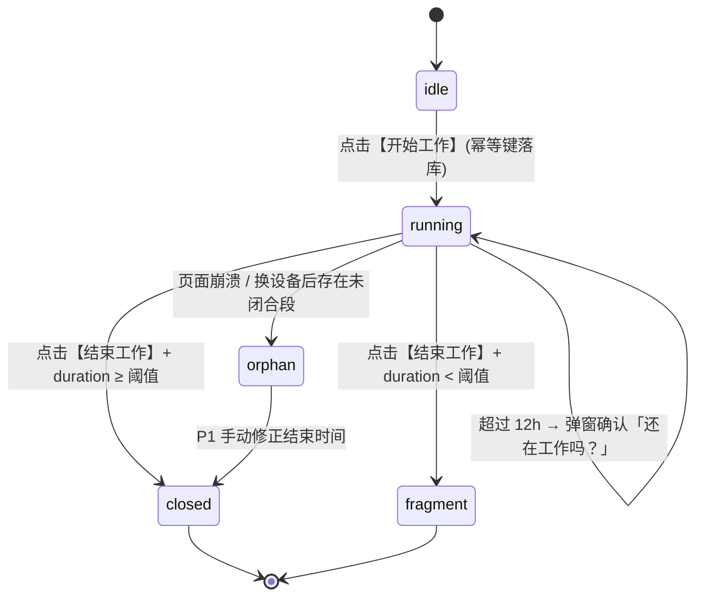
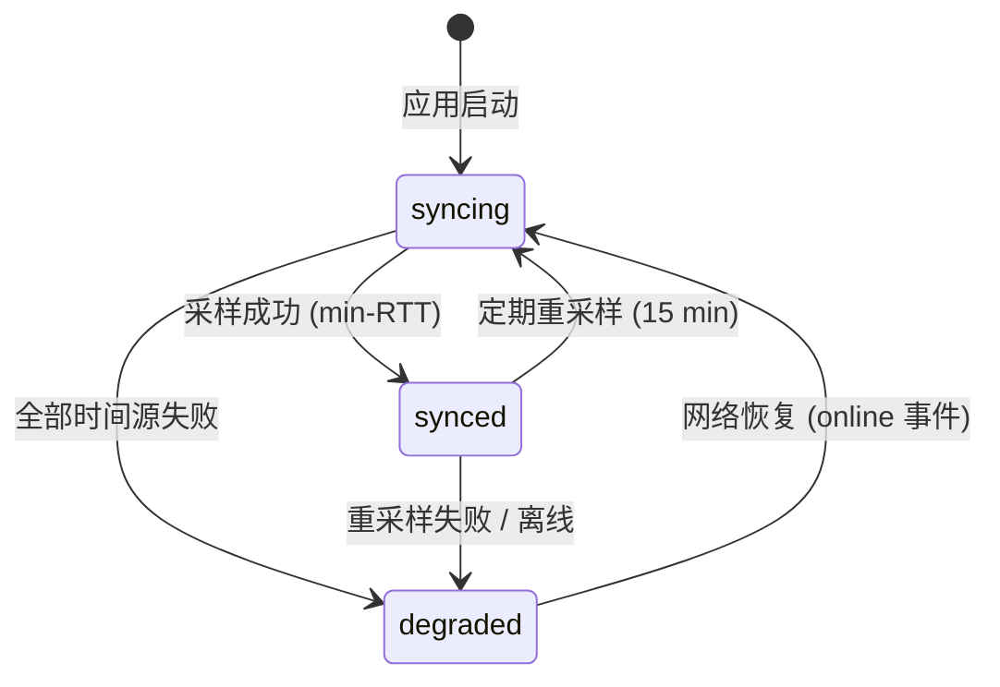
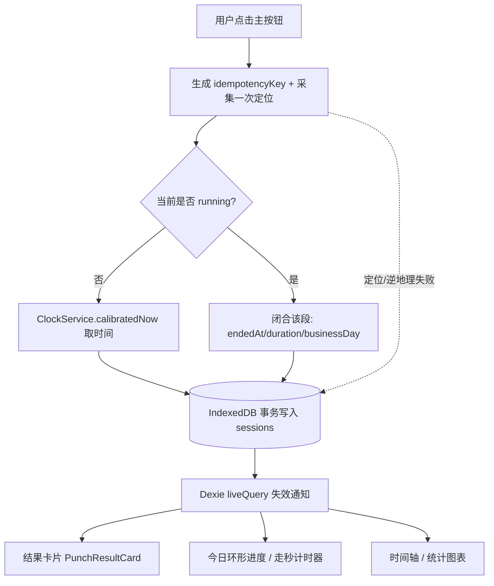

# 技术设计（TECH-DESIGN）

| 项目 | 内容 |
| --- | --- |
| 文档版本 | v1.0 |
| 状态 | 待评审 |
| 最后更新 | 2026-10-12 |
| 上游文档 | `PRD.md`（v1.0 已定稿）、`DECISIONS.md`（D-000 ~ D-014） |
| 下游文档 | `TASKS.md` |

> 本文只做**实现层设计**，不重新讨论产品决策。凡与 PRD 结论不一致处，统一记入 [§14 与 PRD 的偏离](#14-与-prd-的偏离)，需产品侧确认后生效。

---

## 1. 设计目标与约束

| 约束来源 | 落地要求 |
| --- | --- |
| D-012 / D-013 | 零后端：无账号、无服务器、无云数据库；数据仅存 IndexedDB |
| D-014 | 打卡结果卡片 + 图表优先；**图表与明细必须同源**（PRD 验收 #10） |
| PRD §6 | 冷启动 P75 < 2s；打卡点击 → 落库 < 3s（含定位）；必须 HTTPS |
| PRD §4.2 C-6 | 幂等键保证重复点击 / 离线重放不产生重复段 |
| PRD §4.3 L-2 | 定位失败、逆地理失败**都不阻塞**打卡 |
| PRD §9 | 公共时间源不可用时可降级；坐标系必须归一化 |
| D-015 | M1 **只记录坐标**，不接逆地理与地图；provider 先落地空实现 |

**架构原则**

1. **单一数据源**：IndexedDB（Dexie）是唯一真相，UI 全部由 `liveQuery` 派生，不做第二份内存状态。
2. **纯函数内核**：时间校准、坐标转换、地点匹配、工时汇总均为无副作用纯函数，可单测。
3. **外部依赖全部 provider 化**：时间源、定位、地图、逆地理都能替换（PRD §6 可维护性）。
4. **失败可降级**：任一外部依赖失败都有明确的降级结果，绝不让用户卡在打卡这一步。

---

## 2. 技术栈与依赖

| 用途 | 选型 | 依赖（实际安装版本） |
| --- | --- | --- |
| 构建 | Vite 8 + TypeScript 6（`strict: true`） | `vite`, `typescript`, `@vitejs/plugin-react` |
| UI | React 19 | `react`, `react-dom` |
| 路由 | React Router 7 | `react-router-dom` |
| 本地库 | Dexie 4 | `dexie`, `dexie-react-hooks` |
| 图表 | ECharts 6（自 M2 使用） | `echarts`, `echarts-for-react` |
| 地图 / 逆地理 | 高德 JS API 2.0（provider 化，**M3 引入**） | `@amap/amap-jsapi-loader`（待装） |
| PWA | M1 用 `public/manifest.webmanifest` + `public/icon.svg` 提供可安装能力 | 无额外依赖 |
| 日期 | 原生 `Date`（本地时区，业务日边界用 `setMinutes` 计算，DST 安全） | 无额外依赖 |
| ID | `crypto.randomUUID()`（HTTPS 下可用，无需依赖） | — |
| 测试 | Vitest 5 + fake-indexeddb | `vitest`, `fake-indexeddb`, `@testing-library/react` |
| Lint | ESLint 10 + Prettier | `eslint`, `prettier` |

> **按里程碑引入**：图表自 M2 起使用；`vite-plugin-pwa` 的 Service Worker 缓存自 M5 起引入——M1 不接 SW，避免开发期缓存旧资源（见 §13）。

**运行环境**：Node LTS（本机安装于 `~/.local/node`，不入库）；包管理用 `npm`。提交 `package-lock.json`。

---

## 3. 目录结构

```
check_app/
├─ docs/                      # 本文档所在
├─ public/                    # icons、manifest 源文件
├─ index.html
├─ vite.config.ts             # PWA 插件、别名、构建配置
├─ .env.example               # VITE_AMAP_KEY / VITE_AMAP_SECURITY_CODE 占位
├─ src/
│  ├─ main.tsx  App.tsx
│  ├─ app/                    # 路由、全局 Provider、错误边界
│  ├─ config/                 # 常量、env 读取与校验（constants.ts, env.ts）
│  ├─ db/                     # Dexie schema、迁移、仓储（repositories）
│  │  ├─ schema.ts  db.ts  migrations.ts
│  │  └─ repos/{sessions,places,settings,meta}.repo.ts
│  ├─ domain/                 # 纯逻辑，零 IO
│  │  ├─ types.ts             # 领域类型（唯一类型来源）
│  │  ├─ time/                # 校准算法、业务日边界、时长格式化
│  │  ├─ geo/                 # haversine、WGS84↔GCJ02、地点匹配
│  │  └─ stats/               # summarize()：图表与明细的唯一入口
│  ├─ services/               # 外部依赖适配层（provider 接口 + 实现）
│  │  ├─ clock/               # TimeSource providers + ClockService
│  │  ├─ location/            # GeolocationProvider
│  │  ├─ geocode/             # 逆地理 provider（高德 / 空实现）
│  │  ├─ map/                 # 地图渲染适配（高德）
│  │  └─ backup/              # 导出 / 导入 / 校验
│  ├─ features/               # 按页面切分
│  │  ├─ punch/               # 首页：时钟、主按钮、结果卡片、环形进度
│  │  ├─ timeline/            # 记录页：甘特时间轴
│  │  ├─ stats/               # 统计页：柱状图、地点占比、折线
│  │  ├─ places/              # 地点页：增删改 + 地图分布
│  │  └─ settings/            # 设置页：目标、阈值、备份
│  ├─ components/             # 通用 UI 与图表封装（charts/）
│  └─ test/                   # 测试工具与夹具
└─ vitest.config.ts
```

**依赖方向（单向，禁止反向 import）**：`features → services → db → domain`，`components` 为叶子。

---

## 4. 数据模型（IndexedDB / Dexie）

### 4.1 表与索引

```ts
// db/schema.ts  —— Dexie v1
db.version(1).stores({
  sessions: 'id, startedAt, endedAt, businessDay, placeId, idempotencyKey, status, deleted',
  places:   'id, name, deleted',
  settings: 'id',
  meta:     'key',
});
```

> 索引只能建立在 string/number/Date/Array 上（`null` 不可作键），因此软删除用数值标记 `deleted: 0 | 1`，而不是 `deletedAt` 直接建索引。

### 4.2 `sessions`（打卡段）

| 字段 | 类型 | 说明 |
| --- | --- | --- |
| `id` | string | UUID（`crypto.randomUUID()`） |
| `startedAt` | number | **校准后**的网络时间（epoch ms）；离线时 = 本地时间 |
| `endedAt` | number \| null | `null` 表示**进行中**（唯一一条） |
| `durationSeconds` | number \| null | 闭合后写入，避免每次重算 |
| `businessDay` | string | `YYYY-MM-DD`，按业务日边界归属的**开始日** |
| `startLocation` / `endLocation` | `LocationSnapshot` \| null | 内嵌快照（见 4.5） |
| `placeId` | string \| null | 开始时匹配到的地点（软删除地点仍保留 id） |
| `endPlaceId` | string \| null | 结束时匹配到的地点，可与开始不同 |
| `timeSource` | `'network' \| 'local'` | 该条记录的时间来源（PRD T-3） |
| `clockOffsetMs` | number | 打卡瞬间 `网络时间 − 设备时间`，用于偏差展示（PRD T-1/T-3） |
| `deviceStartedAt` | number | 设备墙钟原值，仅作参考字段 |
| `idempotencyKey` | string | 唯一索引，重复点击 / 离线重放的防线（C-6） |
| `status` | `'running' \| 'closed' \| 'fragment' \| 'orphan'` | `orphan` = 历史遗留未闭合段，交由 P1 修正 |
| `isDeviceClockSkewed` | boolean | 偏差 > 60s 时打标（PRD T-4） |
| `note` | string \| null | 备注（P1 编辑用） |
| `editedAt` | number \| null | P1 修改痕迹 |
| `deleted` | 0 \| 1 | 软删除（PRD §7 数据安全要求 2） |
| `createdAt` / `updatedAt` | number | 审计字段 |

**与 PRD §7 字段命名对照**（PRD 用 snake_case 描述，代码统一 camelCase）

| PRD §7 | 代码字段 |
| --- | --- |
| `started_at` / `ended_at` / `duration_seconds` | `startedAt` / `endedAt` / `durationSeconds` |
| 起止坐标与精度、地址 | `startLocation` / `endLocation`（含 `lat`/`lng`/`accuracyM`/`address`） |
| `place_id` | `placeId` / `endPlaceId` |
| 来源（在线 / 离线） | `timeSource` |
| 幂等键 | `idempotencyKey` |
| 设备本地时间与网络时间偏差 | `deviceStartedAt`、`clockOffsetMs` |

### 4.3 `places`（地点）

| 字段 | 类型 | 说明 |
| --- | --- | --- |
| `id` | string | UUID |
| `name` | string | 人类可读名称（D-010 方案 A 的核心价值） |
| `lat` / `lng` | number | **统一存 WGS84**（见 §8.2） |
| `radiusM` | number | 默认 200 |
| `color` | string | 与地点占比图配色联动（PRD V-5） |
| `icon` | string \| null | 可选图标标识 |
| `deleted` | 0 \| 1 | 软删除 |
| `createdAt` / `updatedAt` | number | — |

### 4.4 `settings`（单例）与 `meta`

```ts
interface SettingsRecord {
  id: 'app';
  dailyTargetHours: number;          // 默认 8
  weeklyTargetHours: number;         // 默认 40
  businessDayBoundaryMinutes: number;// 默认 240（04:00 换日，D-008）
  fragmentThresholdSeconds: number;  // 默认 60（PRD §4.5）
  longSegmentThresholdHours: number; // 默认 12（C-5 / D-011）
  defaultPlaceRadiusM: number;       // 默认 200
  timeSourceIds: string[];           // 启用的时间源优先级
  schemaVersion: number;
}
```

`meta` 为 `{ key, value }` KV，承载：`calibrationOffsetMs`、`calibrationAt`、`deviceId`、`lastBackupAt`、`lastImportAt`、`appVersion`。

### 4.5 `LocationSnapshot`（内嵌值对象）

```ts
interface LocationSnapshot {
  lat: number; lng: number;          // 统一 WGS84
  coordSystem: 'WGS84';
  accuracyM: number | null;
  address: string | null;
  poiName: string | null;
  capturedAt: number;
  status: 'ok' | 'denied' | 'timeout' | 'unavailable' | 'error';
  errorCode: number | null;
  reverseGeocode: 'ok' | 'failed' | 'skipped';
}
```

> **关键**：定位失败时**不写 null**，而是写入 `status: 'denied' | 'timeout' | …` 的快照，`lat/lng` 为 `0`，由 `status` 判定有效性。这样 UI 能明确区分「没记录地点」的**原因**（PRD L-2、验收 #7）。

### 4.6 迁移策略

- 每次结构变更新增 `db.version(n).stores({...}).upgrade(tx => ...)`，**只增不删**；
- 导入旧版备份时走同一套 migration（`db/backup` → `migrations`），保证向前兼容；
- `schemaVersion` 同时写入 `settings` 与备份文件头，导入前做版本校验。

---

## 5. 状态机

### 5.1 段（segment）生命周期



**并发不变量**：全局**至多一条** `status='running'`。开始打卡前在**同一事务**内断言不存在 running 段；若存在（异常并发 / 双开标签页），转为「结束该段」的提示，不新建。

### 5.2 时钟状态



UI 顶部状态：`同步中` / `已同步(偏差 ±Xms)` / `未校准(本地时间)`（PRD T-3）。

---

## 6. 时间校准设计（核心，含对 PRD 的实现偏离）

### 6.1 问题：HTTP `Date` 响应头无法跨域读取

PRD §4.1 与 D-007 描述的实现是「请求公共时间源，读取 HTTP `Date` 响应头」。**该方案在浏览器中不可行**：

- `Date` **不属于** CORS 安全列表响应头（安全列表仅 `Cache-Control`、`Content-Language`、`Content-Length`、`Content-Type`、`Expires`、`Last-Modified`、`Pragma`）；
- 因此跨域 JS 读 `response.headers.get('Date')` 只会得到 `null`，除非服务器显式返回 `Access-Control-Expose-Headers: Date`。

**实测结果**（2026-10-12，`Origin: https://example.com`）

| 时间源 | 结果 | 可读时间 |
| --- | --- | --- |
| `https://timeapi.io/api/Time/current/zone?timeZone=UTC` | `200`，`Access-Control-Allow-Origin: *`，**未 expose `Date`** | ✅ JSON 字段 `dateTime`（含毫秒） |
| `https://www.cloudflare.com/cdn-cgi/trace` | `200`，`Access-Control-Allow-Origin: *`，**未 expose `Date`** | ✅ 文本字段 `ts=`（**秒级截断**） |
| `https://worldtimeapi.org/api/timezone/Etc/UTC` | 连接被重置（本网络不可达） | ✖ |
| `https://api.m.taobao.com/...getTimestamp` | DNS 解析失败 | ✖ |
| `https://quan.suning.com/getSysTime.do` | `403` | ✖ |

### 6.2 采用方案：可插拔 `TimeSource` + NTP 简化算法

```ts
type TimeSourceKind = 'jsonTimestamp' | 'textTimestamp' | 'dateHeader';

interface TimeSource {
  id: string;
  label: string;
  kind: TimeSourceKind;
  url: string;
  /** 从响应体解析服务端时间（epoch ms）；dateHeader 模式下读响应头 */
  parse(res: Response): Promise<number>;
  priority: number;
}
```

- 默认内置 `timeapi.io`（主，毫秒级）+ `cloudflare-trace`（备，秒级）；
- 保留 `dateHeader` 模式：供用户填入**自建 / 可 expose `Date`** 的时间源，或日后部署自有静态站点的 `/time` 端点（无需后端逻辑）；
- 时间源清单与优先级可在设置页调整（PRD §4.1 多源降级）。

**采样算法（NTP 简化）**

```ts
// 全程使用单调时钟，避免用户拨动系统时间干扰测量
const t0 = monotonicNow();            // 发包前
const res = await fetch(source.url, { cache: 'no-store' });
const serverTime = await source.parse(res);
const t1 = monotonicNow();            // 收包后
const rtt = t1 - t0;
const offset = serverTime - (t0 + t1) / 2;   // 假设往返对称
```

- 每个源采样 **3~5 次**，**取 RTT 最小**的那个样本（最小 RTT ⇒ 最接近对称路径，误差最小）；
- 多源之间取**最小 RTT 源的 offset** 为准，其余作为合理性校验（偏差 > 2s 视为异常源并降级）；
- 结果写入 `meta.calibrationOffsetMs`，并每隔 15 分钟重采样。

**单调时钟**：应用启动时记 `epochAtPerfStart = Date.now() - performance.now()`，之后 `monotonicNow() = epochAtPerfStart + performance.now()`。校准时间 `calibratedNow() = monotonicNow() + offset`。

> ⚠️ 精度声明：Cloudflare `ts` 为整秒（误差可达 ±500ms），`timeapi.io` 为毫秒级。工时统计精度需求为「分钟」，两者均满足；偏差展示字段会标注取值来源。若后续需要更高精度，可加自建静态 `/time` 端点（返回 `Date` 头 + 毫秒体）。

### 6.3 打卡时的落库规则（PRD T-1 / T-4 / T-5）

| 场景 | `startedAt` 取 | `timeSource` | 标记 |
| --- | --- | --- | --- |
| 已同步 | `calibratedNow()` | `network` | — |
| 未校准 / 离线 | `deviceNow()` | `local` | `offline`（报表区分展示） |
| 偏差 \|offset\| > 60s | `calibratedNow()` | `network` | `isDeviceClockSkewed = true` + 提示「设备时间异常」 |

**T-5 不篡改历史**：恢复网络后只更新 `meta.calibrationOffsetMs` 与「补记参照值」，**绝不回写**任何已落库 `startedAt`/`endedAt`。

---

## 7. 定位与逆地理

### 7.1 定位（D-004：仅打卡时采集一次）

```ts
interface GeolocationProvider {
  getOnce(opts?: { timeoutMs?: number; highAccuracy?: boolean }): Promise<LocationSnapshot>;
}
```

- 实现 `navigator.geolocation.getCurrentPosition`，`maximumAge: 0`；
- **打卡不阻塞在定位上**：段落库先完成，地点随后补写（§10），因此「点击 → 落库」与定位耗时无关（PRD §6）。打卡路径定位超时 `3s`（`GEOLOCATION_PUNCH_TIMEOUT_MS`），首页展示型定位超时 `8s`；超时按 L-2 落库但不记录地点；
- **安全上下文检查**：非 HTTPS / localhost 时直接返回 `status:'unavailable'`，UI 给出明确提示（PRD §6 必须 HTTPS）；
- 失败映射：`PERMISSION_DENIED→denied`、`TIMEOUT→timeout`、`POSITION_UNAVAILABLE→unavailable`；
- **永不 throw 到打卡主流程**（L-2）：定位结果与落库解耦，先落库时间，定位结果异步补齐或直接标注失败。

**首页「当前地址」展示**（D-004 例外条款）：页面可见时以 **60s** 间隔 + `enableHighAccuracy:false` 刷新，**不落库**；`document.visibilityState === 'hidden'` 时暂停。

### 7.2 逆地理（高德）

> **M1 状态（D-015）**：M1 **仅落地 provider 接口 + 空实现**（`NoopGeocodeProvider`），本节的高德实现顺延到 M3。M1 的打卡结果卡片展示坐标与精度，不展示地址与地图。

- 通过 `@amap/amap-jsapi-loader` 按需加载 `AMap.Geocoder` 插件；
- Key 走环境变量 `VITE_AMAP_KEY`（`.env.local`，**不入库**），`.env.example` 只放占位符；
- 逆地理失败 / 未配置 Key → `reverseGeocode:'failed'|'skipped'`，`address` 留空，UI 显示「未记录地点」「地址解析不可用」，**不阻塞**（L-3/L-4、验收 #7）；
- provider 抽象允许替换腾讯 / 百度（PRD §6 可维护性）。

### 7.3 坐标系归一化（PRD §9 风险）

| 来源 | 坐标系 |
| --- | --- |
| `navigator.geolocation` | WGS84 |
| 高德（地图渲染 / 逆地理返回） | GCJ-02 |

**约定：库内一律 WGS84。** 读写两向都过转换层：

```ts
// domain/geo/coord.ts —— 标准算法，纯函数
wgs84ToGcj02(lat, lng): { lat, lng }
gcj02ToWgs84(lat, lng): { lat, lng }   // 迭代逼近，3 次即可收敛到亚米级
```

- 写入：导航坐标直接存 WGS84；
- 渲染：丢给高德地图 / `AMap.Geocoder` 前转 GCJ-02；
- 高德返回的 `location` → 转回 WGS84 再入库。

---

## 8. 地点匹配（D-010 方案 A）

```ts
// domain/geo/match.ts —— 纯函数
matchPlace(point: {lat, lng}, places: PlaceRecord[]): PlaceRecord | null
```

1. 过滤 `deleted === 0`；
2. Haversine 计算距离，候选 = `distance <= radiusM`；
3. **多个命中取最近**；距离相同则取半径更小者（更"精确"的地点优先）；
4. 无候选 → `null`，UI 展示原始地址 + 提供「一键命名为新地点」入口（P-3）。

半径默认 200m，可在设置页改默认值，也可逐个地点调整。

---

## 9. 统计口径实现（PRD §4.5）

```ts
// domain/stats/summarize.ts —— 唯一汇总入口
interface RangeSummary {
  range: { start: number; end: number; label: string; preset: 'today'|'week'|'month'|'custom' };
  totalSeconds: number;      // 全部段
  effectiveSeconds: number;  // 排除 fragment
  fragmentSeconds: number;
  targetSeconds: number;
  achievement: number;       // 0~1+
  byDay: DayBucket[];
  byPlace: PlaceBucket[];    // 含未匹配的「未命名地点」桶
  sessions: SessionView[];
}
summarize(sessions: SessionRecord[], places: PlaceRecord[], settings: SettingsRecord, range: DateRange): RangeSummary
```

**规则落地**

| 规则 | 实现 |
| --- | --- |
| 计时单元 | 段成对闭合；`endedAt === null` 的进行中段按 `calibratedNow()` 计算**实时时长**参与今日合计，但标记为 `running`（不写库） |
| 日工时 | Σ 有效段 |
| 碎片阈值 | `durationSeconds < settings.fragmentThresholdSeconds` → `status='fragment'`，计入 `fragmentSeconds`，**不计入工时**（保留记录） |
| 跨天 | `businessDay` 在**开始时**确定：`startedAt` 减去 `businessDayBoundaryMinutes` 后取日期；段归属开始日，跨 0 点不拆分（D-008） |
| 未闭合段 | **不伪造工时**；持续计时 + 超 12h 弹窗；`orphan` 段单独统计并在 UI 提示待修正（D-011） |
| 目标达成 | `achievement = effectiveSeconds / (dailyTargetHours × 3600)`；周视图用 `weeklyTargetHours` |
| 图表 = 明细 | 图表与列表**都只消费 `RangeSummary`**，禁止各自再算一遍（验收 #10） |

> 该函数被单测覆盖为「图表与列表明细一致性」的验收依据（见 §12）。

---

## 10. 数据流



**写路径要点**

1. **先落库、后补地点**：为保证「点击 → 落库 < 3s」（PRD §6），段落库**完全不等定位**；定位结果在拿到后二次写入同一记录（`locationSettled`），结果卡片通过 `liveQuery` 订阅记录、自动更新为坐标或失败原因。这样即使页面在定位返回前被关闭，时间也已安全落库；
2. 幂等：按钮在 `pending` 期间禁用 + `idempotencyKey` 唯一索引兜底；
3. 所有写操作包在 `db.transaction('rw', ...)` 中，含「至多一条 running」的断言。

**读路径**：`useLiveQuery` + repository 封装的 `summarize()`，避免在组件里散落查询。

---

## 11. 备份格式与导入策略（M1，PRD 验收 #9）

```jsonc
{
  "format": "check_app.backup",
  "formatVersion": 1,
  "schemaVersion": 1,
  "appVersion": "0.1.0",
  "exportedAt": 1760274176000,
  "deviceId": "…",
  "counts": { "sessions": 120, "places": 4 },
  "checksum": "sha256:…",       // 对 data 规范化 JSON 计算
  "data": { "sessions": [], "places": [], "settings": {}, "meta": {} }
}
```

- **导出**：全量导出（含软删除记录）；成功后写 `meta.lastBackupAt`；
- **提醒**：设置页展示「上次备份时间」；超过 7 天在首页显示提醒条（PRD §9 对决 Safari 清理策略）；
- **导入**：① 校验 `format`/`formatVersion`/`checksum` → ② 预览计数差异 → ③ 选择模式：
  - **覆盖**（默认）：清空后写入；
  - **合并**：以 `idempotencyKey` 去重，`places` 以 `id` 去重；
- 全程单事务，失败整体回滚，**不产生半套数据**；
- P1：备份加密（可选，AES-GCM + 用户口令派生密钥）。

---

## 12. 测试策略

| 层 | 工具 | 覆盖重点 |
| --- | --- | --- |
| 纯函数单测 | Vitest | 时间校准（构造不同 RTT / 时钟漂移）、`businessDay` 边界（03:59 / 04:00 / 跨 0 点）、碎片阈值、WGS84↔GCJ02 往返误差、Haversine 匹配 |
| 汇总一致性 | Vitest | **`summarize()` 的 `byDay`/`byPlace` 合计 == `sessions` 逐条累加 == 图表数据源**（验收 #10） |
| 存储层 | Vitest + `fake-indexeddb` | 幂等键唯一约束、至多一条 running、软删除不外泄、migration |
| 备份往返 | Vitest | 导出 → 清库 → 导入 ⇒ 全量等值（验收 #9） |
| 组件 | Testing Library | 定位被拒仍可打卡（验收 #7）、结果卡片必现（验收 #2） |
| e2e（可选，M2 起） | Playwright | 多段打卡 → 时间轴 → 统计数字一致 |

---

## 13. 构建、部署与安全

| 项 | 方案 |
| --- | --- |
| 构建 | `vite build` → `dist/` 纯静态 |
| 部署 | Vercel / Cloudflare Pages；**必须 HTTPS**（定位 API 前提） |
| **SPA 回退** | 应用用 `BrowserRouter`，`/timeline`、`/settings` 是真实 URL，静态托管默认会 404。已内置 `vercel.json`（rewrites）与 `public/_redirects`（`/* /index.html 200`，Cloudflare Pages / Netlify 通用） |
| PWA | M1 只用 `public/manifest.webmanifest` + `public/icon.svg` 提供**可安装**能力；Workbox / Service Worker 缓存策略留到 M5（避免开发期 SW 缓存旧资源） |
| 高德 Key | 环境变量注入；在高德控制台配置**域名白名单 + 调用限额**（PRD §9 Key 滥用风险） |
| CSP | 建议 `default-src 'self'`，显式放行高德域名与时间源域名，降低 XSS 面 |
| 隐私 | 无任何上报 / 埋点 / 分析；位置数据仅存本机 |

---

## 14. 与 PRD 的偏离

| # | PRD 原文 | 实际实现 | 原因 | 需确认 |
| --- | --- | --- | --- | --- |
| D1 | §4.1 / D-007：读取 HTTP `Date` 响应头 | 解析 CORS 可用端点的时间字段；保留 `dateHeader` 模式 | `Date` 非 CORS 安全列表头，跨域不可读（§6.1 实测） | ✅ |
| D2 | §4.2「段成对闭合」 | 进行中的段以 `endedAt: null` 落库 | 需要跨页面刷新 / 崩溃后恢复计时（C-4、D-011） | ✅ |
| D3 | §4.5 未闭合段「不自动伪造工时」 | 进行中段按当前校准时间实时计入今日合计并标记 `running` | 否则首页「今日累计」在打卡中就无意义 | ✅ |
| D4 | §9 时间精度隐含「毫秒级可信」 | 主源毫秒、备源整秒，偏差 >2s 判为异常源 | 公共免费时间源精度有限（§6.2 实测） | ✅ |

---

## 15. 待确认问题（Open Questions）

| # | 问题 | 影响 | 建议默认 |
| --- | --- | --- | --- |
| ~~Q1~~ | ~~是否已有高德 JS API Key~~ | — | **已定（D-015）**：M1 不接入地址与地图，只记录坐标；provider 留空实现，M3 再注入 Key |
| ~~Q2~~ | ~~时间源默认清单~~ | — | **已按默认实现**：`timeapi.io`（主）+ `cloudflare-trace`（备），设置页可调整，保留自建 `/time` 端点扩展位 |
| Q3 | 是否需要 `git init` 并建仓库？ | 版本管理、回滚能力 | 需要 |
| Q4 | 部署目标（Vercel 还是 Cloudflare Pages） | Key 白名单域名、构建配置 | 暂不部署，本地 `vite preview` 验证 |
| Q5 | M1 是否包含 PWA 离线安装（Workbox）还是仅 manifest？ | M1 范围 | 仅 manifest + 可安装，SW 缓存留到 M5 |

---

## 16. 里程碑技术映射

| 里程碑 | 技术交付 |
| --- | --- |
| **M1** | Dexie schema v1 + ClockService（多源校准）+ GeolocationProvider（记录坐标）+ 逆地理 **空实现** + 多段打卡状态机 + 今日时间轴 + 结果卡片（无地址 / 地图）+ 备份导出 / 导入 + Vitest 基建 |
| M2 | `summarize()` 完整口径 + ECharts 柱状图 / 环形进度 + 结果卡片动效 |
| M3 | 地点 CRUD + 自动匹配 + 地点占比图 + 高德地图分布 |
| M4 | 手动补录 / 编辑（含 `editedAt` 痕迹）、离线补传、CSV 导出、日历热力图 |
| M5 | PWA 安装引导、SW 缓存策略、多时间源容错、备份加密 |
